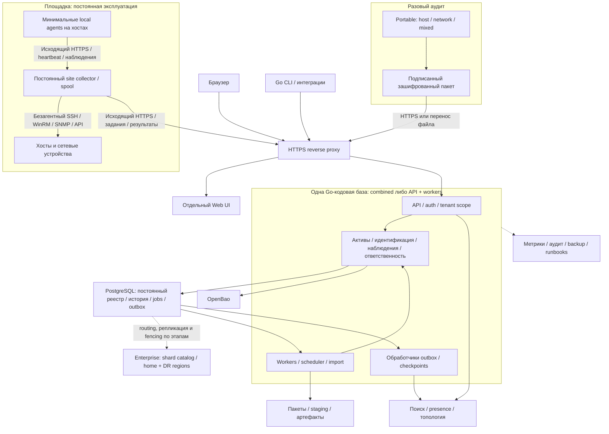
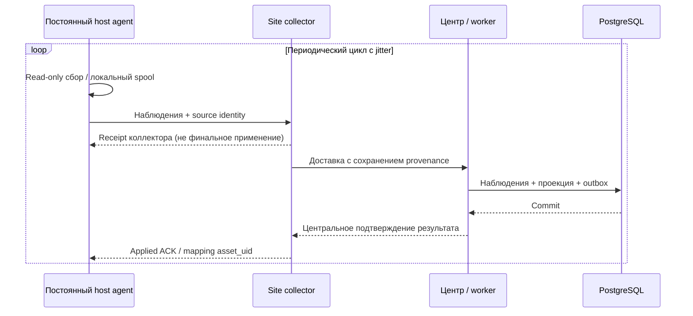
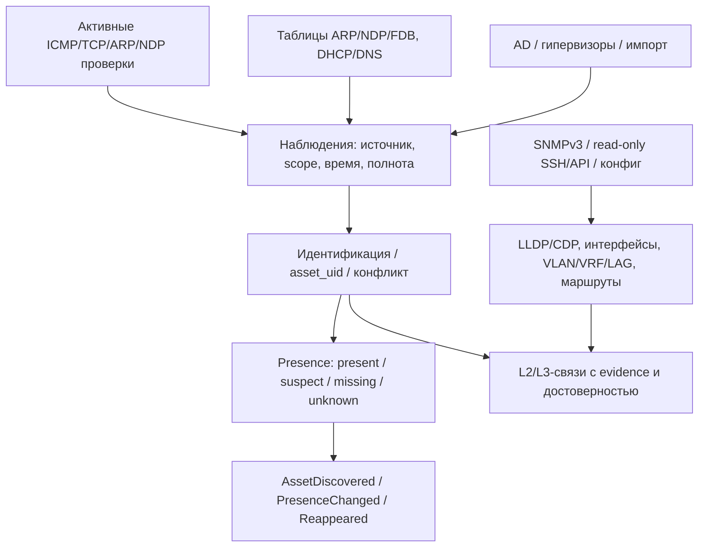
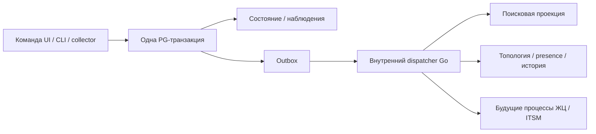
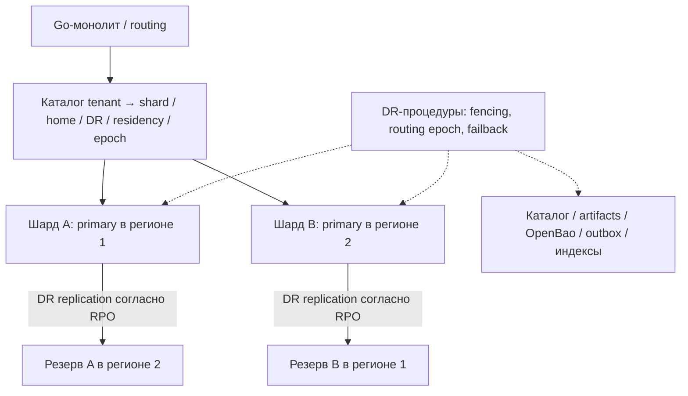

# Целевая архитектура surveyscan на Go

Дата: 2026-11-03. Версия проекта: 0.5, уточнения R-008/R-009.
Основной документ: [спецификация v2 0.5](../specifications/go-asset-management-v2.md).
Выбор пользователя: OpenBao; agentless discovery/topology; сквозной ID, ответственность,
CLI/открытый API; событийность без внешней шины; поиск Tantivy или Bluge; георезервирование.
Модель данных уточняется. CMDB как трактовка «smdb» остаётся предположением.

## 1. Общая схема и независимые компоненты поставки

Серверный Web UI не вшивается в Go-бинарник: своя сборка/версия/pipeline, статический hosting.
Предлагаемая схема same-origin: / — UI, /api — backend. Reverse proxy может отдавать UI сам.
Конкретный proxy и frontend-фреймворк ещё не выбраны; Nginx — пример.
Ни CDN, ни Node.js runtime на production-сервере статической SPA не обязательны.
Embedded UI сохраняется только возможной опцией portable для автономной поставки.

Базовый подход 0.5: проектировать независимые роли api/worker с общей кодовой базой;
для малой установки сохранить роль combined API+worker. Это не обязательный переход к микросервисам.
API, worker и статика масштабируются независимо. Сессии/задания/артефакты не привязаны
к памяти одного процесса. Индексам нужны явные writer/readers; общий файл не масштабирование поиска.
Минимальный серверный контур: Web UI/proxy + Go backend + PostgreSQL + OpenBao + артефакты;
collector на площадке или рядом. Поисковый движок по-прежнему выбирается.
Пул SQL и HTTP-балансировщик решают разные задачи.

## 2. Три сценария сбора: постоянный агент, collector и portable

Последнее уточнение R-011 заменяет прежнюю трактовку local как частного случая portable.

| Компонент | Где работает | Жизненный цикл | Передача |
|---|---|---|---|
| Local/host agent | на каждом выбранном управляемом хосте | минимальная постоянная служба, расписание и heartbeat | исходящий HTTPS к назначенному collector |
| Site collector | на площадке/в сегменте | постоянная служба, приём агентов и безагентный сбор | исходящий HTTPS к центру, долговечный spool |
| Portable | компьютер аудитора/цель разового обследования | запуск по требованию, без установки службы | пакет через HTTPS либо перенос файла |

Agentless — параллельный сценарий, установка host agent не обязательна на всех активах.
Сетевое оборудование обследуется collector через разрешённые протоколы. Постоянный агент
не превращается в сканер всей сети. Scope host/network/mixed не равен роли local agent.
Общие SDK/адаптеры и формат наблюдений переиспользуются; права и lifecycle различаются.

Portable работает offline без обязательных PG/Docker/OpenBao; секреты вводятся локально
или выдаются отдельным санкционированным bundle. Он не становится постоянным источником
heartbeat после окончания аудита. Локальный UI portable остаётся возможной опцией.

Разрыв связи и перезапуск не очищают неподтверждённые результаты. Очереди ограничены,
backoff и disk-full имеют явную политику. agent_id/collector_id не подменяют asset_uid;
переустановка и клонирование образов обрабатываются как возможный конфликт идентичности.

## 3. OpenBao

Сервер хранит secret_ref и метаданные, не собственный каталог открытых паролей.
OpenBao KV — статические секреты; поддержанные engines — динамические credentials;
Transit — криптографические операции. Это разные функции.
Collector получает только разрешённое конкретным заданием; bootstrap, policies, TTL/renewal,
отзыв и ротация — обязательная часть реализации. Никаких root-токенов приложения.
Прямой доступ collector к OpenBao или ограниченная выдача через сервер выбирается ADR с учётом
площадок, которым доступен только HTTPS endpoint центра.
При отказе OpenBao секретозависимые задания ждут/ошибаются явно, остальные функции продолжаются.
Истечение токена не меняет уже прочитанный статический пароль на цели.
OpenBao/ключи/unseal/backup включаются в георезервирование; функции конкретной версии проверяются,
не предполагается готовая межрегиональная репликация без PoC.

## 4. Обнаружение и топология

Отсутствие ответа одного протокола не означает исчезновение. Negative evidence учитывает
успешное покрытие области, живой источник, тип актива, TTL и согласованные пороги.
Отказ collector/площадки, частичный scan, ошибка доступа или смена scope не создают
массовое missing. Late offline-пакеты не откатывают текущую доступность автоматически.
Presence — техническое наблюдение; lifecycle — управленческий процесс второй волны.
IP сопоставляется с tenant/site/VRF/VLAN; перекрывающиеся пространства не сливаются.
Устройство из пассивной таблицы не становится автоматически разрешённой целью активного скана.

Сетевые активы дают инвентарь и топологические таблицы. FDB не доказывает прямую физическую связь:
учитываются trunk/LAG/несколько переходов, двусторонние соседи, возраст и противоречия.
Подтверждённые и предполагаемые связи различимы. Vendor capabilities документируются.

## 5. Сквозная идентичность и ответственность

asset_uid — постоянный канонический UUID во всех API/CLI/событиях/индексах/карточках
и будущем складе/ITSM. Он не зависит от IP, площадки, tenant routing, региона или шарда.
Неизвестный offline-актив имеет source_record_id + кандидаты идентичности. Reconciliation
возвращает mapping source → asset_uid. Два автономных сборщика не могут гарантированно
выдать одинаковый UID неизвестному физическому устройству заранее.
Merge сохраняет aliases/redirects; split — новый UID и историю. UID не переиспользуется.

Отдельные ID: scan/job/attempt/package/observation/event. correlation/causation связывают обработку.
Conceptual model требует согласования asset vs CI vs component vs service и правил merge/split.

Каждый актив имеет актуальную ответственную роль с историей интервалов.
Новый актив назначается fallback-команде tenant/site, пока не назначен персонально.
Business owner, технический ответственный и custodian — разные назначения.
Передача атомарна; уход сотрудника вызывает переназначение/разбор, не бесхозность.
Сложные акты и согласования передачи — вторая волна.

## 6. События и полнотекстовый поиск без шины

At-least-once доставка, inbox/checkpoints, версии агрегата, retries/dead letter и replay.
Нет глобального порядка событий между шардами. Replay не повторяет внешние действия автоматически.
Kafka/NATS/RabbitMQ не нужны. Возможный будущий transport не меняет доменные команды.
Это не обязательный event sourcing: авторитет — PostgreSQL и наблюдения.

Поиск: Tantivy или Bluge, выбор после PoC русского/английского текста, IP/FQDN/serial,
ranking/facets, ACL, обновлений/удалений, rebuild, лицензии и сопровождения.
Индекс — восстановимая проекция PG. Обновляется по outbox, имеет watermark/lag и tombstones.
Права/tenant проверяются до результатов/snippets/facets/counts, отзыв доступа не ждёт индекс.
Падение поиска не блокирует запись; полный поиск сообщает деградацию.
Для multi-instance нужен явный writer/reader ownership по индексам; совместная запись
в файловый индекс несколькими процессами не предполагается. Rebuild: snapshot + checkpoint + catch-up.

## 7. Георезервирование шардов

Размещение резерва на рисунке иллюстративно и допустимо только при разрешённом residency.
Один writer на шард — базовое предложение. Active-active одного актива не обещается.
Async replication допускает потери в пределах согласованного RPO; sync имеет стоимость RTT/доступности.
Failover требует fencing, нового routing epoch и согласования обработки заданий.
Failback отдельно тестируется. UID актива не меняется при DR/переносе.
Пул/балансировщик не заменяет routing или DR.
Копируются/восстанавливаются не только PG, но и каталог, artifacts, OpenBao/ключи,
dedup ledger/outbox/checkpoints и поисковые данные/rebuild.
Нельзя обещать exactly-once после DR с ненулевым RPO. Повтор пакетов и последствия для
проекций проверяются на fault-injection стенде.
Геомодель проектируется сразу; число физических шардов определяется нагрузкой.

## 8. Продуктовые волны

| Волна | Состав |
|---|---|
| 1 | Технический реестр AM/CMDB, безагентный сбор, discovery/presence, топология, ID, ответственность, OpenBao, API/CLI, события, поиск, геопроектирование и DR-приёмка |
| 2 | Процессы ЖЦ; приём/выдача/возврат/ремонт/списание; склад, запчасти, резервы и движения |
| 3 | ITSM: инциденты, запросы, изменения, проблемы, каталог услуг, SLA |

Волна 2 различает серийные экземпляры и количественные партии; движения атомарны,
не допускают двойной выдачи/отрицательного остатка. Замена компонента сохраняет
связь с asset_uid и историю. Подробные workflow согласуются отдельной спецификацией.
ITSM использует общий asset_uid и реестр, не дублирует идентичность активов.

## 9. Следующий шаг

Согласовать ER-модель/сквозной ID, policies OpenBao/offline, discovery presence, ownership,
географию и RPO/RTO; выполнить PoC Bluge/Tantivy, затем зафиксировать ADR.
Первый рабочий SMB-срез E1: постоянный host agent → постоянный collector → API/worker → PG + outbox → регулярно обновляемая карточка. Portable-аудит и широкий безагентный сбор вводятся следующей эпохой E2.
В первом срезе есть tenant isolation, стабильный asset_uid, fallback responsibility, машинная идентичность, минимальная роль пользователя, история, spool/ACK, backup и health/freshness.
Код в этой сессии не меняется. Требования не означают выполненную реализацию.

См. [спецификацию 0.5](../specifications/go-asset-management-v2.md) и
[историю первоначального обсуждения](https://github.com/QgMixtate/surveyscan/blob/73ced7efbacdd6a60466e16d5e77e61587842e9c/docs/architecture/go-asset-management-discussion.md).

## 10. Границы модулей и последующее выделение сервисов — R-009

Целевое разделение разработки: frontend, backend, collectors/inventory, infrastructure.
Это владельцы направлений, не требование четырёх отдельных команд или репозиториев.
Один монорепозиторий может иметь /web, /contracts, /cmd и /internal с отдельными pipelines.
UI/API совместимость — OpenAPI, mock/contract/E2E tests и таблица релизов.

Модуль владеет таблицами/миграциями, инвариантами и интерфейсом; прямые записи в таблицы
другого модуля запрещены. Межмодульные эффекты идут через интерфейсы и outbox-события.
Общие транзакции, если временно есть, явно документируются как препятствия выделению.

Кандидаты выделения по подтверждённой необходимости:
1. Обработка импорта/заданий — сначала отдельная worker-role того же приложения.
2. Поиск/индексация — когда нужна независимая ёмкость/технология.
3. Тяжёлые отчёты и интеграции — при отдельном профиле нагрузки/отказов.
4. Будущие workflow/ITSM — при самостоятельной команде и цикле релиза.

Для реального сервиса требуются контракт, auth/timeouts/retries/idempotency, владение данными,
backfill/catch-up, cutover и rollback. Распределённые инварианты пересматриваются;
нельзя обещать «просто вынести функцию по HTTP». External broker пока не вводится.

## 11. Что означает ориентир 100 пользователей

Встраивание статики в бинарник само по себе не определяет лимит пользователей.
Разделение полезно для независимых релизов/команд и изоляции ресурсов.
Предлагаемый нагрузочный профиль: 100 одновременно активных пользователей
с поиском, карточками, правками, топологией и фоновым импортом.
До теста фиксируются think time, смесь операций, объём данных, длительность, железо,
RTT, p95/p99 и допустимые ошибки. Проверяется отключение API-реплики и насыщение worker.
Нагрузочные тесты в рамках изменения документа не выполнялись; SLA не объявлен достигнутым.

Источники для механизмов:
- https://nginx.org/en/docs/http/load_balancing.html
- https://go.dev/pkg/embed/

## 12. Развёртывание 0.5: выбранный подход и границы

Основание: подтверждение пользователем подхода «проектировать под раздельные API/worker,
сохранив combined» и запрос общей архитектуры и спецификации. Это согласование направления,
а не утверждение всех ADR, численных SLO или разрешение начать миграцию.

| Контур | Компактный запуск | Раздельные роли |
|---|---|---|
| Web UI | отдельные assets за reverse proxy | те же assets, независимый релиз |
| Go-backend | один combined-процесс | API replicas + worker-процессы |
| Доменные контракты | общие модули | те же модули, данные принадлежат владельцам |
| Задания и события | PostgreSQL jobs/outbox | те же jobs/outbox, claim/lease/checkpoints |
| Поиск | библиотека/проекция по выбранному ADR | согласованная топология writer/readers, без общей конкурентной записи |
| Артефакты | локальный каталог | общее доступное хранилище с проверкой прав |
| БД | один кластер | сначала один кластер; физические шарды по измерениям |

Схема выше логическая: блоки routing и pool не означают обязательные отдельные сервисы.
Обработчики outbox могут исполняться в worker-role с отдельными лимитами и ownership;
их запуск отдельным сервисом не требуется. Одно событие может обрабатываться разными
потребителями, у каждого свои checkpoints. Фоновая оркестрация скана выполняется workers,
сетевой доступ к целям выполняет collector на разрешённой площадке.
Стрелки DR обозначают охват восстановления, а не одинаковый механизм репликации всех компонентов.
Прямая выдача секретов collector из OpenBao либо выдача через центр остаётся ADR.

## 13. Доменные модули и владельцы данных

| Модуль | Собственные данные / инварианты | Основной контракт |
|---|---|---|
| Identity / Access | технические идентичности, роли, tenant scope | авторизация API и фоновых операций |
| Assets / Reconciliation | asset_uid, identifiers, aliases, конфликты | определить/создать актив, merge/split |
| Inventory | observation/section, current facts, provenance | принять наблюдения и обновить проекцию |
| Discovery / Presence | покрытие, источники, last_seen, переходы | подтвердить присутствие/неизвестность |
| Topology | нормализованные связи, evidence, confidence | построить граф и экспорт |
| Jobs / Collectors | регистрации, расписания, попытки, lease | выдать, отменить и завершить задание |
| Imports / Artifacts | package/upload, digest, staging, checkpoints | принять, проверить и применить пакет |
| Responsibility | назначения person/team, интервалы и fallback | передать ответственность атомарно |
| Search | индекс, checkpoints, lag | поиск с актуальной проверкой прав |
| Integrations / Reports | экспортные задания и delivery state | сформировать результат с учётом доступа |

Таблица — проект ownership, уточняется ER-моделью. Прямые записи в чужие таблицы запрещены.
Outbox принадлежит транзакции владельца изменения; аудит и проекции имеют согласованные контракты.
Данные текущей карточки не удаляются вместе с рабочими материалами одного скана.

## 14. Постоянный и разовый потоки результатов

Постоянно: конфигурация/регистрация → host agent по расписанию → collector с долговечным spool →
API/staging → worker validation/reconciliation → PG observations/current facts/outbox →
идемпотентные проекции → UI/CLI → финальное подтверждение источнику.
Heartbeat, last inventory, полнота секций, presence и бизнес-статус различаются.

Безагентно: scheduler → collector площадки → SSH/WinRM/SNMP/API/источники discovery → тот же import pipeline.
Нельзя записывать missing по ошибке источника, неполному покрытию или неответу одного протокола.

Разово: portable → локальный preview/пакет → HTTPS либо перенос файла → тот же проверяемый импорт.
Неизвестный offline-актив получает source-local ID; центр возвращает mapping на asset_uid.
Ручные бизнес-поля защищены от перезаписи сбором; поздние наблюдения дополняют историю.

## 15. Что осталось выбрать

ER-модель asset/CI/component/service, reconciliation, framework Web UI, схема auth/SSO,
формат и криптография пакета, язык portable, допустимость sh/PowerShell/Nmap,
Tantivy/Bluge и его runtime-топология, продукт SQL pool, платформы, retention, offline-policy,
география, RPO/RTO и нагрузочные SLO. Уточнения — в реестре D-01–18 спецификации.

## 16. Статус поставки и реализация

Документы 0.4 — проект целевой системы. Рабочий код в main остаётся Python v1 с Go-коннектором.
Подготовленная облачная среда не доказывает реализацию Go v2. Первый этап — короткий E0, затем постоянно работающий SMB-релиз E1;
процессы ЖЦ/склад и ITSM не входят автоматически в объём E1.
Версия 0.5 подготовлена локально для просмотра; публикация в GitHub не выполнена.

## 17. Поставки по эпохам

E0 фиксирует базовые контракты и решения первого среза. E1 — отдельный UI, Go combined,
один PG, host agent и collector, минимальный реестр/API/CLI, периоды, heartbeat/spool/ACK,
auth/tenant isolation, история/ответственная команда, outbox, backup/restore и метрики.
Один выбранный платформенный стенд, затем расширение Windows/Linux в E2.
В E1 допускается точный поиск PG; полнотекстовый движок и его сложная топология не блокируют релиз.

E2 — расширенный агентный и безагентный сбор, topology/discovery, portable-аудит.
E3 — зрелый AM/CMDB, расширенная идентификация и FTS. E4 — интеграции/миграция.
E5 — раздельные процессы/реплики по нагрузке, HA, физические шарды и geo DR.
Затем волна 2 — ЖЦ/склад/запчасти/движения, волна 3 — ITSM.

Границы модулей, UID, tenancy, происхождение и миграции присутствуют с начала;
несколько регионов, сложные workflows и микросервисы не являются условиями первой полезной поставки.
Непрерывная работа — регулярное обновление с контролем свежести и восстановления, не обещание 100% uptime.
Приёмка E1 содержит 24-часовой стендовый прогон с restart/outage; SLA задаётся отдельными измерениями.

## 18. Основания и проверка замечаний

Все замечания R-011 сопоставлены с требованиями и эпохами в [матрице](../specifications/requirements-traceability-v0.5.md).
Официальная документация аналогов и ограничения доказательств: [исследование](../research/inventory-platform-analogues.md).
GLPI подтверждает различие managed/autonomous и proxy-модели; Device42 — site RC, agent-based/offline;
runZero — постоянно работающие Explorers и CLI для offline. Это референсы паттернов,
а не доказательство паритета surveyscan или уникальности продукта.
