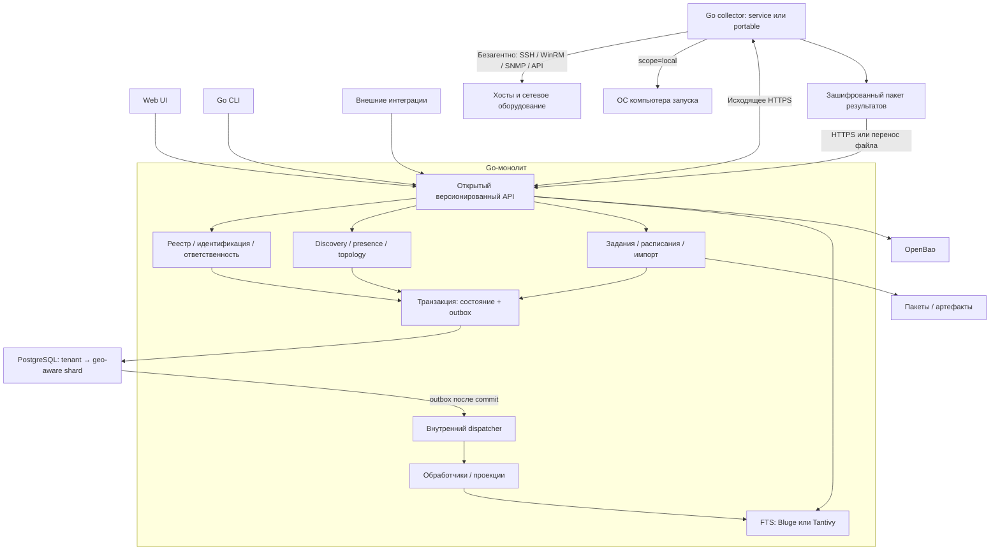
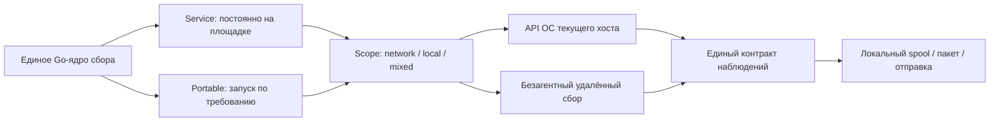
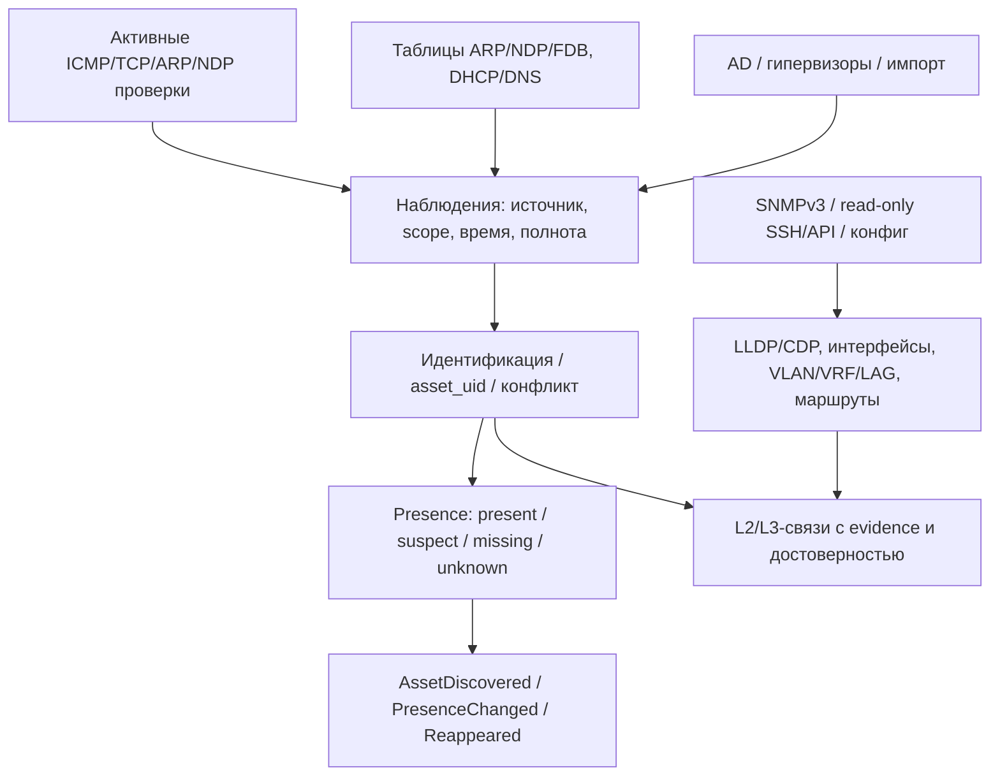
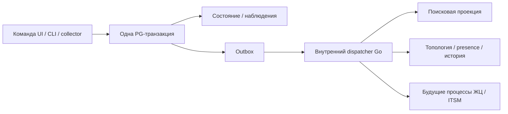
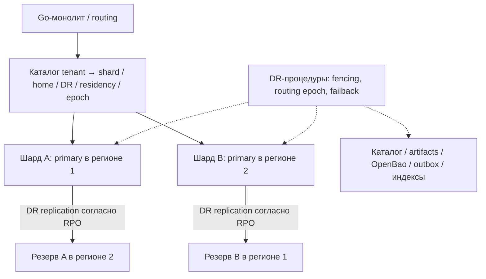

# Целевая архитектура surveyscan на Go

Дата: 2026-11-02. Версия проекта: 0.2, уточнение R-008.
Основной документ: [спецификация v2 0.2](../specifications/go-asset-management-v2.md).
Выбор пользователя: OpenBao; agentless discovery/topology; сквозной ID, ответственность,
CLI/открытый API; событийность без внешней шины; поиск Tantivy или Bluge; георезервирование.
Модель данных уточняется. CMDB как трактовка «smdb» остаётся предположением.

## 1. Общая схема

Серверный монолит имеет внутренние модули; PostgreSQL и OpenBao — внешняя инфраструктура.
Встроенный Bluge сохраняет чистую Go-поставку. Tantivy — альтернатива через Rust/FFI либо
отдельный процесс; это решение о поставке пока не принято.
Малая установка: server + PG + OpenBao (внешний или свой) + артефакты + collector.
Web UI локально поставляется с сервером; никаких CDN при работе.

## 2. Сборщик: два способа запуска, а не три продукта

Local — частный случай portable, когда обследуется компьютер запуска.
Наличие служебного collector на площадке не означает установки агента на каждом активе.
Удалённые цели обследуются по доступным протоколам/правам. Agentless не означает отсутствие
WinRM/SSH/SNMP и системных служб на целях. Допустимость PowerShell/sh/Nmap всё ещё уточняется.

Portable: local/network/mixed, без обязательных PG/Docker/OpenBao в момент offline-работы.
UI на loopback; локальное встроенное хранилище; предварительно доверенный ключ получателя.
Секреты вводятся локально либо выдаются отдельным санкционированным зашифрованным bundle;
не входят в пакет результатов. Срок offline-секрета и риск невозможности немедленного отзыва явны.

## 3. OpenBao

Сервер хранит secret_ref и метаданные, не собственный каталог открытых паролей.
OpenBao KV — статические секреты; поддержанные engines — динамические credentials;
Transit — криптографические операции. Это разные функции.
Collector получает только разрешённое конкретным заданием; bootstrap, policies, TTL/renewal,
отзыв и ротация — обязательная часть реализации. Никаких root-токенов приложения.
Прямой доступ collector к OpenBao или ограниченная выдача через сервер выбирается ADR с учётом
площадок, которым доступен только HTTPS endpoint центра.
При отказе OpenBao секретозависимые задания ждут/ошибаются явно, остальные функции продолжаются.
Истечение токена не меняет уже прочитанный статический пароль на цели.
OpenBao/ключи/unseal/backup включаются в георезервирование; функции конкретной версии проверяются,
не предполагается готовая межрегиональная репликация без PoC.

## 4. Обнаружение и топология

Отсутствие ответа одного протокола не означает исчезновение. Negative evidence учитывает
успешное покрытие области, живой источник, тип актива, TTL и согласованные пороги.
Отказ collector/площадки, частичный scan, ошибка доступа или смена scope не создают
массовое missing. Late offline-пакеты не откатывают текущую доступность автоматически.
Presence — техническое наблюдение; lifecycle — управленческий процесс второй волны.
IP сопоставляется с tenant/site/VRF/VLAN; перекрывающиеся пространства не сливаются.
Устройство из пассивной таблицы не становится автоматически разрешённой целью активного скана.

Сетевые активы дают инвентарь и топологические таблицы. FDB не доказывает прямую физическую связь:
учитываются trunk/LAG/несколько переходов, двусторонние соседи, возраст и противоречия.
Подтверждённые и предполагаемые связи различимы. Vendor capabilities документируются.

## 5. Сквозная идентичность и ответственность

asset_uid — постоянный канонический UUID во всех API/CLI/событиях/индексах/карточках
и будущем складе/ITSM. Он не зависит от IP, площадки, tenant routing, региона или шарда.
Неизвестный offline-актив имеет source_record_id + кандидаты идентичности. Reconciliation
возвращает mapping source → asset_uid. Два автономных сборщика не могут гарантированно
выдать одинаковый UID неизвестному физическому устройству заранее.
Merge сохраняет aliases/redirects; split — новый UID и историю. UID не переиспользуется.

Отдельные ID: scan/job/attempt/package/observation/event. correlation/causation связывают обработку.
Conceptual model требует согласования asset vs CI vs component vs service и правил merge/split.

Каждый актив имеет актуальную ответственную роль с историей интервалов.
Новый актив назначается fallback-команде tenant/site, пока не назначен персонально.
Business owner, технический ответственный и custodian — разные назначения.
Передача атомарна; уход сотрудника вызывает переназначение/разбор, не бесхозность.
Сложные акты и согласования передачи — вторая волна.

## 6. События и полнотекстовый поиск без шины

At-least-once доставка, inbox/checkpoints, версии агрегата, retries/dead letter и replay.
Нет глобального порядка событий между шардами. Replay не повторяет внешние действия автоматически.
Kafka/NATS/RabbitMQ не нужны. Возможный будущий transport не меняет доменные команды.
Это не обязательный event sourcing: авторитет — PostgreSQL и наблюдения.

Поиск: Tantivy или Bluge, выбор после PoC русского/английского текста, IP/FQDN/serial,
ranking/facets, ACL, обновлений/удалений, rebuild, лицензии и сопровождения.
Индекс — восстановимая проекция PG. Обновляется по outbox, имеет watermark/lag и tombstones.
Права/tenant проверяются до результатов/snippets/facets/counts, отзыв доступа не ждёт индекс.
Падение поиска не блокирует запись; полный поиск сообщает деградацию.
Для multi-instance нужен явный writer/reader ownership по индексам; совместная запись
в файловый индекс несколькими процессами не предполагается. Rebuild: snapshot + checkpoint + catch-up.

## 7. Георезервирование шардов

Размещение резерва на рисунке иллюстративно и допустимо только при разрешённом residency.
Один writer на шард — базовое предложение. Active-active одного актива не обещается.
Async replication допускает потери в пределах согласованного RPO; sync имеет стоимость RTT/доступности.
Failover требует fencing, нового routing epoch и согласования обработки заданий.
Failback отдельно тестируется. UID актива не меняется при DR/переносе.
Пул/балансировщик не заменяет routing или DR.
Копируются/восстанавливаются не только PG, но и каталог, artifacts, OpenBao/ключи,
dedup ledger/outbox/checkpoints и поисковые данные/rebuild.
Нельзя обещать exactly-once после DR с ненулевым RPO. Повтор пакетов и последствия для
проекций проверяются на fault-injection стенде.
Геомодель проектируется сразу; число физических шардов определяется нагрузкой.

## 8. Продуктовые волны

| Волна | Состав |
|---|---|
| 1 | Технический реестр AM/CMDB, безагентный сбор, discovery/presence, топология, ID, ответственность, OpenBao, API/CLI, события, поиск, геопроектирование и DR-приёмка |
| 2 | Процессы ЖЦ; приём/выдача/возврат/ремонт/списание; склад, запчасти, резервы и движения |
| 3 | ITSM: инциденты, запросы, изменения, проблемы, каталог услуг, SLA |

Волна 2 различает серийные экземпляры и количественные партии; движения атомарны,
не допускают двойной выдачи/отрицательного остатка. Замена компонента сохраняет
связь с asset_uid и историю. Подробные workflow согласуются отдельной спецификацией.
ITSM использует общий asset_uid и реестр, не дублирует идентичность активов.

## 9. Следующий шаг

Согласовать ER-модель/сквозной ID, policies OpenBao/offline, discovery presence, ownership,
географию и RPO/RTO; выполнить PoC Bluge/Tantivy, затем зафиксировать ADR.
Первый срез: portable local/network → пакет → API/CLI → PG + outbox → постоянная карточка.
В первом срезе уже есть tenant isolation, secret references и fallback responsibility.
Код в этой сессии не меняется. Требования не означают выполненную реализацию.

См. [спецификацию 0.2](../specifications/go-asset-management-v2.md) и
[историю первоначального обсуждения](go-asset-management-discussion.md).
