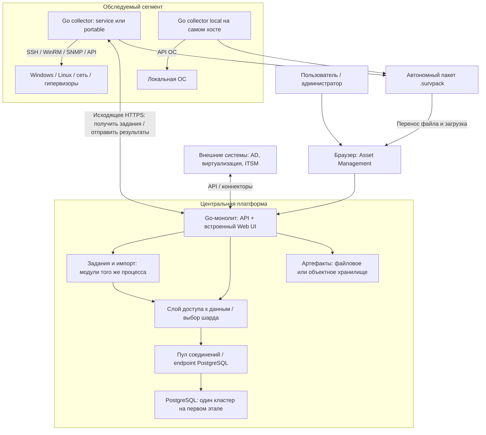
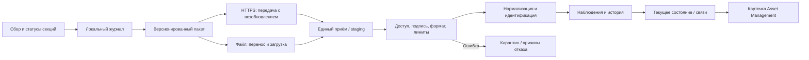
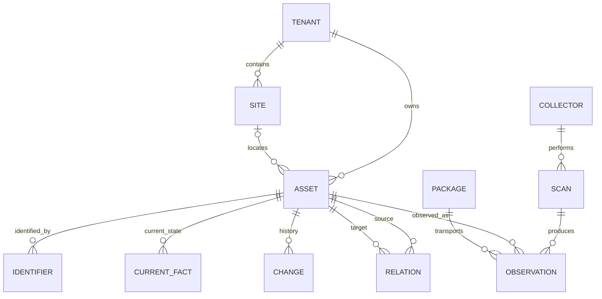
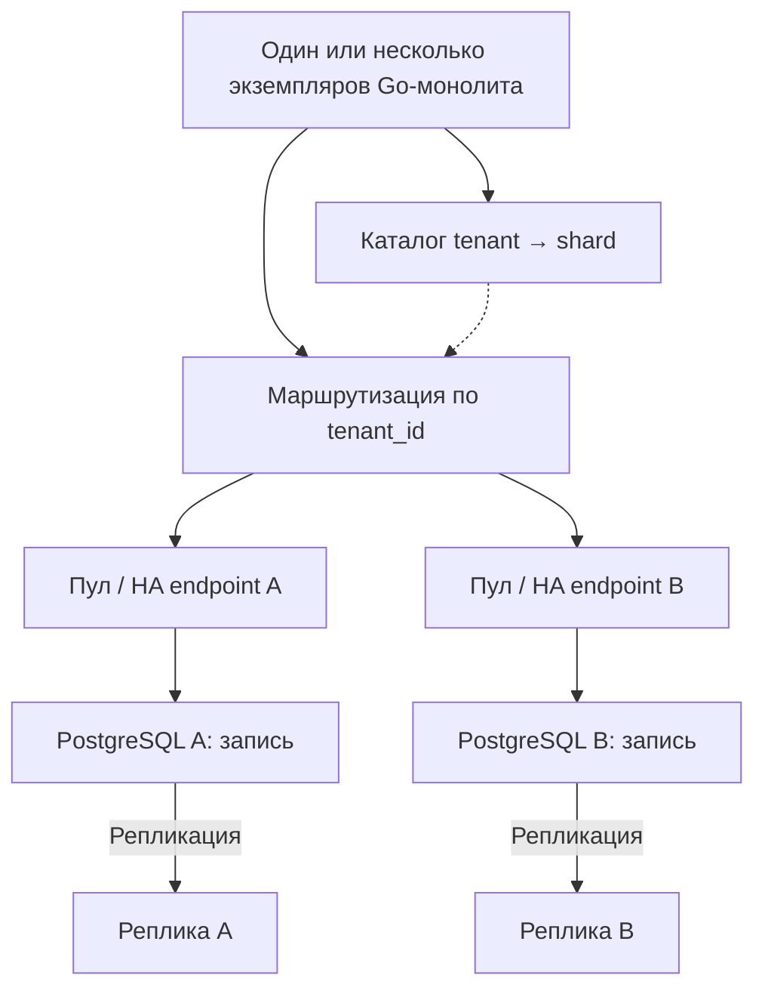

# Целевая архитектура surveyscan на Go

Дата: 2026-11-02. Версия: проект 0.1, для обсуждения R-005.
Не утверждённое ТЗ. CMDB — предположение о значении «smdb». Конкретный пул/балансировщик,
допустимость скриптов/Nmap, масштабы и приоритет режимов portable ещё обсуждаются.

## 1. Общая схема

Монолит — одно серверное приложение с внутренними модулями. PostgreSQL, хранилище
артефактов и сборщики — инфраструктура и отдельные исполняемые компоненты.
Для маленькой установки collector может работать рядом с сервером; серверу не обязательно
иметь доступ ко всем обследуемым сетям. На площадках collector сам инициирует HTTPS к центру.

## 2. Внутренние модули Go-сервера
- Web UI/API: локально собранные ресурсы в бинарнике, REST API и контракт OpenAPI.
- Доступ: организации, площадки, роли, права, авторизация каждого запроса.
- Assets/CMDB: постоянные активы/CI, бизнес-поля, жизненный цикл, типизированные связи.
- Inventory: наблюдения, нормализация, идентификация, текущее состояние, история.
- Jobs: расписания, очередь в PostgreSQL, ограничения параллелизма, отмена, повторы.
- Import/export: приём пакетов, валидация, карантин, экспорт и подтверждения.
- Topology: связи, источник и степень достоверности; наблюдаемые и предполагаемые связи различаются.
- Integrations: AD/LDAP, гипервизоры, ITSM и другие источники по согласованному объёму.
- Reports/search: поиск и отчёты с ограничением областью доступа.
- Audit/operations: журнал действий, метрики, диагностика, резервирование и восстановление.

Внутренние модули вызываются через Go-интерфейсы, отдельная сеть между ними не нужна.
Очередь долговечная: lease, heartbeat, повторная выдача после сбоя и идемпотентная обработка.
Уведомление о задании может ускорять работу, но источником истины остаётся сохранённая очередь.
Между хранилищем файлов и PostgreSQL нет общей транзакции: staging, контрольные суммы,
явные состояния импорта, очистка осиротевших файлов и повторяемые шаги.

## 3. Один сборщик, три режима
- service: постоянно работающий сборщик сегмента, получает задания, хранит локальную очередь,
  переживает разрыв связи, отправляет данные после восстановления.
- portable: запускаемый без установки инструмент обследователя, удалённый сбор сети,
  локальный просмотр и экспорт/отправка пакета.
- local: запуск на отдельном обследуемом компьютере для сбора через API ОС.

Предлагаемая поставка: surveyscan-server и surveyscan-collector с режимами service/portable/local.
Общий Go-код: адаптеры, модели, версия схемы, пакетирование, журнал статусов, повторная передача.
Отдельные сборки для ОС/архитектур. Rust на первом этапе не предлагается.
Portable: SQLite или иное встроенное рабочее хранилище, никаких обязательных PostgreSQL/Docker.
Web UI portable слушает loopback; локальная сессия защищена временным токеном.
Секреты: в памяти или защищённом хранилище ОС, не в пакете. В offline-режиме пользователь вводит
доступы локально. В service-режиме источник секретов/выдача ограничиваются назначенным заданием.
Удалённый сбор зависит от протоколов и разрешений; бинарник сам по себе не обеспечивает полный доступ.
Нативные API для local; SSH/WinRM могут требовать команд/скриптов на целях. Это отдельное решение.

## 4. Прохождение результатов

Пакет: manifest, package_id, collector_id, scope, организация/площадка, версии,
время сбора, поток наблюдений, статусы разделов, контрольные суммы, допустимые артефакты.
Подпись источника и шифрование на ключ получателя; доверенные ключи регистрируются заранее.
Подпись не доказывает истинность данных ОС. tenant_id из пакета сверяется с авторизацией отправителя.
Лимиты распаковки/размера/числа записей, запрет обхода путей, поддерживаемые версии схемы.
Повторный package_id в пределах организации не создаёт новые активы и не повторяет эффекты.
Подтверждение загрузки означает сохранность пакета; окончательный статус импорта приходит отдельно.
Удаление локального пакета только после достаточного подтверждения и по политике хранения.
Поздний импорт сохраняет историческое наблюдение; актуальность определяется временем/источником,
с учётом недостоверных часов и правил приоритета. Отказ сбора не равен удалению актива.

## 5. Данные Asset Management / CMDB

Все предметные записи scoped по организации. UUID актива постоянный; IP/MAC/hostname — идентификаторы,
а не первичные ключи. Нужны правила сопоставления, ручное разрешение конфликтов и аудит merge/split.
CURRENT_FACT хранит значение, источник, observed_at, received_at и статус качества.
Бизнес-поля (владелец, ответственный, назначение, критичность, жизненный цикл) отдельно от сканируемых.
Наблюдения по политике хранения неизменяемые; текущая проекция обновляется по правилам приоритета.
Отношение хранит source_asset, target_asset, тип, источник, время, достоверность, статус подтверждения.
Пример связи: сервер → размещает VM → исполняет приложение → поддерживает бизнес-сервис.
ПО, установки ПО, интерфейсы, диски и службы — отдельные связанные записи; JSONB для вариативных фактов.
Хост/ПО/сервис не обязаны становиться отдельными управляемыми CI автоматически — типы и уровень
детализации согласуются. Финансовый учёт, закупки и лицензии не включены без отдельного определения объёма.

## 6. PostgreSQL: от одной установки к шардам

Первый этап: только A; каталог может быть простой конфигурацией. Шарды B+ вводятся по нагрузке.
tenant_id — кандидат ключа шардинга, ещё не финальный выбор. Очень крупная организация и
межплощадочные связи требуют отдельной стратегии. Каталог маршрутов тоже требует резервирования.
Tenant-scoped ключи и ограничения, UUID, миграции схемы по всем шардам, контролируемое перемещение
организации между шардами. Не обещать распределённые JOIN/транзакции обычного PostgreSQL.
Глобальные отчёты — контролируемая агрегация; отдельное аналитическое хранилище только при необходимости.
История может партиционироваться по времени внутри шарда; это не межсерверный шардинг.
Пул, маршрутизация шарда и failover — отдельные обязанности. Конкретный pgBalancer/PgBouncer не выбран.
Чтения, требующие свежих данных, идут на primary; реплики допускаются с явной терпимостью к задержке.
Выбор нового primary требует механизма HA и fencing; сам рисунок реплики не означает автоматический failover.
В первой версии очередь в одном кластере; при шардинге — очереди организаций на их шардах, глобальный
планировщик обходит каталог. Исключить двойное выполнение через lease и идемпотентность.

## 7. Поставка и эксплуатация
Минимум: Go-сервер + PostgreSQL + каталог артефактов; collector рядом или на площадке.
Пул опционален на малой установке, внешняя очередь/Redis обязательными не являются.
Рост: несколько экземпляров того же монолита за HTTPS-балансировщиком, общие артефакты,
распределённое владение заданиями через БД, HA PostgreSQL. Микросервисы для этого не обязательны.
Закрытый контур: UI и зависимости поставляются заранее, интернет при работе не требуется.
Резервировать БД, артефакты и ключи; проверять восстановление. Retention отдельно для истории,
сырых артефактов, аудита и локального spool. Логи не содержат секретов; импорт и ручные правки аудируются.
Метрики: очередь, ошибки/длительность сбора, неполные секции, импорт, лаг данных, объём истории.

## 8. Первый проверяемый срез
Go local/portable → Windows и Linux → .survpack → Go API → PostgreSQL → карточка.
Приёмка: повторный импорт без дублей, потеря связи и возобновление, частичные данные,
поздний пакет, несовместимая схема, tenant isolation, ручные поля не затираются.
Затем service collector, расписания, сетевые устройства, CMDB-связи, интеграции и масштабирование.
Python-фикстуры сохранять как эталон; текущие исправления не считать автоматически перенесёнными.

## Открытые решения
Подтвердить CMDB, точный продукт балансировки, масштабы, требование об отсутствии скриптов,
минимальные ОС, приоритет portable/local и объём управленческого/лицензионного учёта.
