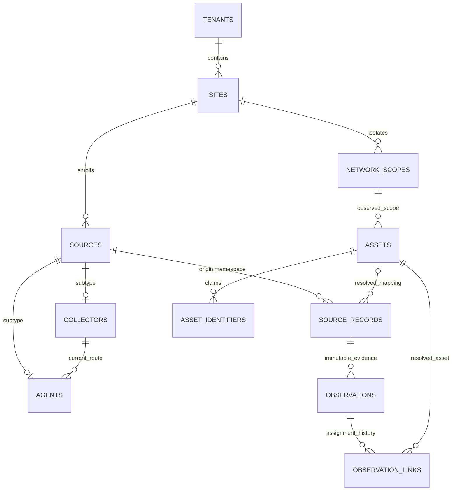

# C02.01 — минимальная ER-модель идентичности E1

Дата: 2026-11-03. Вход: [C01 scope](C01-smb-scope.md), спецификация 0.5 §§2/5/9/19.
Статус: инженерная модель для C03/C04; это не SQL-миграция и не результат работы БД.
Машиночитаемый каталог: [C02-model.json](C02-model.json). Всего 24 логические сущности:
8 базовых областей и минимальная поддержка observations/ownership/delivery/outbox.
Полные auth/job/schedule, software/CI/components, warehouse и ITSM таблицы здесь не проектируются.

## 1. Идентичности и области

`asset_uid` — выданный центром UUIDv4, неизменяемый и не кодирующий IP/site/tenant/shard.
В одном PG есть UNIQUE(asset_uid); при будущих шардах уникальность не выдаётся за глобальный
межшардовый SQL-index. Коллизии проверяются при приёме/миграции, UUID не переиспользуются.
Предметные связи используют `(tenant_id, asset_uid)`: знание UUID не заменяет авторизацию.
Передача между tenant не делается простой сменой поля: это отдельный будущий workflow с правами/аудитом.

`agent_id` обозначает регистрацию службы, `collector_id` — регистрацию площадочного процесса;
`source_id` — стабильный origin сведений, `source_record_key` — нормализованную запись источника.
UUID этих объектов не равны asset_uid и не доказывают физическую уникальность устройства.

## 2. Ключ источника и смена маршрута

Стабильный mapping: **(tenant_id, origin_source_id, namespace, source_local_id) → asset_uid**.
Agent-origin использует source_id агента даже при транзите через collector. Для remote-скана
origin может быть source_id collector. Portable — зарегистрированный логический источник аудита;
его package_id, run_id и ID файла не подменяют origin/source record identity.

`collector_id` в конверте доставки — транспортный маршрут и provenance, а не универсальный
ключ актива. При перепривязке агента к другому разрешённому collector origin и mapping сохраняются.
Для старого collector-origin контракта `(collector_id, namespace, source_record_id)` —
частный случай этой модели, а не требование менять UID при смене агента/маршрута.
Регистрация источника, его namespace и привязка tenant/site устанавливаются авторизацией центра.

`sources` имеет source_kind agent/collector/portable. `agents` и `collectors` — однотипные
расширения source через UNIQUE/FK и проверку discriminator; agent с source_kind=collector запрещён.
Source generations разделяют монотонные sequence после разрешённого сброса/re-enrollment;
новая generation не даёт права создавать новую tenant или автоматически склеивать активы.
Повтор source state на клоне с противоречащим evidence — признак конфликта, а не доказательство того же хоста.
Полностью неразличимый клон с копией ключа и всех признаков не обещается надёжно обнаружить в E1;
ключ/agent_id не считается достаточным доказательством физической идентичности.

## 3. Минимальное разрешение идентичности

1. Проверить авторизованную tenant, origin, generation и scope; raw `asserted_asset_uid` — только claim.
2. Известный source record с непротиворечивыми признаками использует прежний mapping.
3. Для нового source record без конфликтующих кандидатов создать новый asset, ответственность и историю атомарно.
4. Совпадение IP/MAC/hostname **не** приводит к автоматическому merge. Для существующих похожих
   активов хранить candidates/conflict; неоднозначный record может остаться unresolved без назначения asset_uid.
5. Сильные признаки (например, machine UUID/serial с namespace) тоже могут клонироваться:
   противоречие создаёт reconciliation_conflict; E1 не обещает полноценный C25 merge/split.
6. Ручная/предварительная привязка нового источника к известному asset требует полномочий,
   сопоставления evidence и аудита. Межtenant связь отклоняется независимо от совпадения идентификаторов.

Детерминированное правило E1: автоматический reuse только проверенного существующего mapping.
Автоматическое cross-source matching не включается молча. Точные policy codes/ошибки закрепит C03.
Неразрешённое наблюдение сохраняется с origin и conflict state; оно не создаёт бесхозную карточку,
поскольку ещё не является созданным asset. UI отображает отдельную очередь разбора.

## 4. История сопоставления

`source_records.asset_uid` — текущий mapping, а не способ перепривязать все прошлые observations.
Для каждого применённого наблюдения сохраняется `observation_links` со своим asset_uid и revision.
При исправлении назначения старая связь закрывается, создаётся новая и выполняется контролируемый
rebuild затронутой проекции. Неизменяемый payload observation остаётся исходным.
В E1 сложные reassignment/merge/split операции не публикуются; структура не делает их доступными.

## 5. Типы, ключи, constraints

- UUID: tenant/site/scope/source/agent/collector/asset/observation/event IDs. UTC `timestamptz`
  для времён, bigint для sequence/version, typed enums/check для states; facts — JSONB.
- Все scoped PK и ссылки включают tenant_id. Scope asset связан также с site_id одной FK,
  чтобы нельзя было указать site A и scope site B в пределах одной tenant.
- Namespace идентификатора содержит правила нормализации и область: tenant/site/network context;
  VRF/VLAN — расширение E2, не текущая реализованная capability. E1 использует default site scope.
- Индексы поиска по kind/namespace/normalized_value не делают IP/MAC/hostname/serial глобально UNIQUE.
  Одинаковые значения разных активов остаются evidence для конфликта.
- `asset_business_fields` принадлежит Assets и имеет отдельный revision. Наблюдаемый hostname
  находится в Inventory; он не перезаписывает ручной display_name/purpose/criticality/tags.
- `assets.aggregate_version` обслуживает согласованные доменные изменения; бизнес-форма
  использует свой revision/ETag, чтобы новый heartbeat не делал все ручные формы устаревшими.
- Assets не удаляется вместе с scan или source. Tombstone/retired state и retention — явные операции.

Точные индексы и SQL constraints реализуются в C04/C06; этот документ не утверждает их выполнение.
