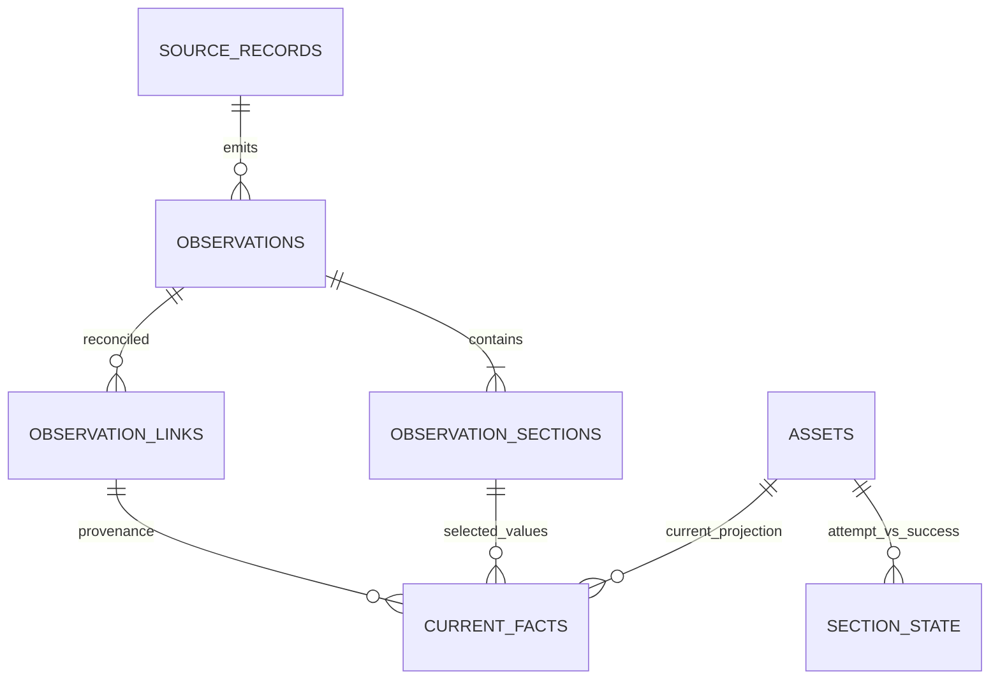

# C02.02 — наблюдения, секции и текущие факты

Дата: 2026-11-03. Связи и поля: [модель](C02-model.json), идентичность: [C02.01](C02-identity-model.md).
Статус: проект поведения для C03/миграций, без реализации projector.

## 1. Неизменяемое наблюдение

Наблюдение содержит origin/source_record, generation, sequence, collected_at/received_at,
clock_quality, digest и исходные факты. `received_at` устанавливает центр; время relay не делает
старую инвентаризацию свежей. Heartbeat — отдельная source operation, не inventory observation.

Уникальны `(tenant_id, observation_id)` и `(tenant_id, source_id, generation_id, source_record_key, sequence)`.
Одинаковый ключ с тем же digest возвращает предыдущий результат; другой digest — конфликт,
а не overwrite. Digest и канонические байты определит C03. После записи payload/sections не исправляются
in-place; исправление приходит новым observation. Retention сохраняет audit и целостность ссылок:
удаление referenced observation требует предварительной согласованной компактизации provenance,
а не CASCADE удаления текущих фактов/карточки.

## 2. Семантика секций

| Статус | Значение | Влияние на существующие facts |
|---|---|---|
| ok | Достоверный успешный результат, включая пустой | Обновляет допустимые facts; удаление отсутствующих элементов только для полной authoritative коллекции |
| partial | Часть сведений доступна | Обновляет только явно собранные пригодные facts; отсутствие элементов не означает удаление |
| unavailable | Запрошено, но нет доступа/источник отказал | Сохраняет прежние успешные значения с указанием их возраста |
| unsupported | Источник не поддерживает секцию | Не заменяет успешные значения пустотой/false |
| not_requested | Профиль не запрашивал секцию | Не меняет прошлые значения, явно показывает профиль |
| unknown | Старый импорт без достоверного статуса | Исторический факт неопределённой полноты; не вытесняет более надёжные факты автоматически |

`record_count >= 0`, reason_code безопасный, `collection_complete` задан отдельно от exit code.
`ok` и `[]` без подтверждённой полноты не дают права массово удалять прежнюю коллекцию.
В E1 количество/пустота относится только к объявленным полям, глубокие секции не симулируются.

## 3. Детерминированная проекция

1. Проверить source authorization, link к asset и policy revision. Неразрешённое observation хранится,
   но не меняет current_facts. Запрещённая tenant не проходит этап авторизации.
2. В пределах source/generation/source_record collection sequence возрастает в момент сбора,
   а не отправки. Повтор/более низкий sequence не откатывает уже выбранный факт.
3. Временная аномалия помечает clock_quality и freshness uncertainty. Для одной надёжной generation
   порядок sequence сильнее регрессировавших wall-clock часов; это не разрешение подменить identity.
4. Между разными источниками учитывать явно заданный приоритет и только пригодное доверенное время.
   При равенстве/неопределённости E1 сохраняет выбранный факт и отмечает конфликт; порядок доставки
   или случайный новый UUID не служат правилом «последний победил».
5. Новая generation проходит авторизованный reset и continuity policy. Sequence=1 новой generation
   не сравнивается численно с sequence=100 старой. Неясность → history/conflict без молчаливого rollback.
6. Scalar E1 values обновляются по допустимому набору фактов. Future collection-replacement требует
   ok + complete + authoritative scope; partial-отсутствие не означает delete.
7. Сохранить fact value, provenance link/observation/section, projection_revision и policy_revision;
   изменение и outbox записываются в согласованной транзакции.

История observations не зависит от того, победили ли они в проекции. Текущая проекция воспроизводима
по сохранённой версии policy и назначениям observation_links. Смена policy/reassignment — аудируемая
операция rebuild, а не невидимое редактирование истории.

## 4. Попытка, успех, контакт и присутствие

`section_state.last_attempt_id` — наиболее новый пригодный по policy запрос секции,
`last_success_id` — наиболее новый успешный полный результат. Partial/failed attempt может
обновить диагностику, сохранив last_success и прежние значения. Частичные пригодные новые facts
могут иметь собственную provenance, даже если полного успешного снимка ещё нет.

`source.last_contact_at` не обновляется по повторной доставке старого heartbeat. Для agent за relay
нужен подтверждённый момент контакта origin и trust/clock quality, не просто текущий контакт collector.
Новый collector heartbeat не доказывает, что все его агенты живы. Детали fresh heartbeat envelope — C03.

Freshness, section completeness, source health, asset presence и lifecycle — разные понятия.
В E1 есть source health/freshness/неполнота; полноценный missing/reappeared по покрытию и TTL — C21.
Транспортный сбой не удаляет asset, не списывает его и не очищает ответственность.

## 5. Независимые ручные поля

Карточка композирует Assets.business_fields + Inventory.current_facts + Responsibility + Sources.health.
Каждый блок читается через порт владельца/согласованную read projection. Ingest не получает права
перезаписывать purpose/display_name/criticality/tags. Пустое имя источника не стирает ручное название.
UI/API контракт этой композиции и ETag фиксирует C03; реальное исполнение — C06/C09.
