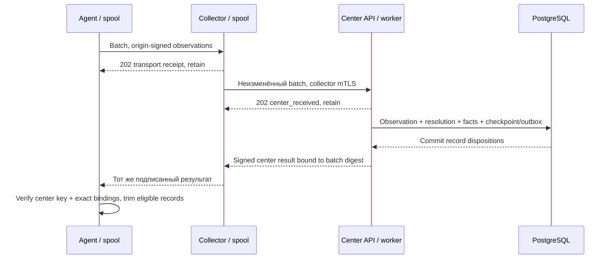

# C03.02 — API и agent → collector → center

Дата: 2026-11-03. [OpenAPI 3.1](../contracts/C03/openapi.json): 26 операций, схемы в components.
Это целевой E1 интерфейс, не перечень реализованных handlers. HTTP/mTLS/PG tests unrun.

## 1. Поверхности и авторизация

| Операции | Доступ / смысл |
|---|---|
| GET /health/live, /health/ready | Без секретов и внутренних адресов; ready может вернуть 503 |
| POST /api/v1/auth/sessions; DELETE /auth/session | Login с rate/origin protection; opaque PG-backed session; logout revoke |
| POST/DELETE /api/v1/auth/tokens[/id] | Ограниченный CLI credential, expiry/revoke; secure storage, не обязательный argv |
| GET /api/v1/assets[/uid]; PATCH /assets/uid | Scoped query; только business fields, If-Match и новый ETag; факты не правятся этим PATCH |
| GET /api/v1/sources[/id] | Scoped source status, contact отдельно от successful inventory |
| POST /api/v1/enrollments | Admin создаёт pending registration и scoped одноразовый grant |
| POST /api/v1/machine/enroll, /machine/renewals | Grant + CSR/signing public key либо действующий mTLS для renewal |
| POST /api/v1/sources/id/generations, /sources/id/revocations | Admin; явный reset continuity/review или отзыв, аудит |
| GET /api/v1/machine/config | Версия профиля, интервалы/секции/квота; без произвольного shell-кода |
| POST /api/v1/machine/observations; GET /machine/deliveries/id | Machine mTLS, bounded batch, транспортный/центральный результат |
| POST /api/v1/machine/heartbeat-challenges, /machine/heartbeats | Fresh challenge и origin signature, защита от replay |
| POST/GET /api/v1/jobs[/id], POST /jobs/id/cancel | Operator/admin scope; create idempotency key, cancel If-Match |
| POST /api/v1/machine/jobs/claims, /machine/jobs/id/attempts | Collector claim/lease/attempt, fencing, bounded retry |

Точные path parameters/схемы/response codes — в OpenAPI, таблица выше укрупнена.
Machine endpoints работают на центре и в применимой relay-поверхности collector с теми же payloads;
collector не реализует пользовательскую авторизацию/реестр/создание jobs.
GET config/renew/status и enrollment агента проходят через collector: прямой доступ agent к центру/Bao не обязателен.
Для agent relay collector предъявляет свой mTLS и зарегистрированное binding origin→collector;
origin signature/CSR/grant проверяет центр. Локальный TLS session source не даёт произвольный чужой origin.

Пользовательская session: HttpOnly/Secure cookie + CSRF token на изменяющих запросах,
SameSite и Origin policy. Токен CLI проверяется по scope. mTLS subject, tenant/site и machine registration
берутся из доверенного auth context. Клиентский заголовок с identity не считается доказательством;
edge identity принимается только от защищённого доверенного edge. Детали TLS/PKI — C05/C11.

Если client запрашивает чужой scoped resource, GET возвращает generic 404, без раскрытия наличия.
Неправомочная операция — 403; body не выбирает tenant вопреки auth context. Перед commit авторизация
и revision/lease проверяются снова. Secrets никогда не возвращаются в обычных source/asset responses.

## 2. Enrollment, generation и renewal

Source сначала локально создаёт private key/CSR и отдельный Ed25519 signing key, передаёт
оператору только public material/fingerprints. Admin grant связывает source_id/kind с tenant/site,
agent collector, SHA256 DER CSR и точным signing public key. TTL до 900s, одноразовое
потребление транзакционно; rate limits и аудит обязательны. CSR proof-of-possession проверяется;
relay не может подменить ключи, хотя видит проходящий через него grant. Точный retry уже
потреблённого grant с тем же public material возвращает прежний public result, а не новый credential.
Enrolled signing key bound к source и tenant; CSR/private key/клиентские поля не выбирают произвольные роли.
Ответ даёт certificate chain, generation, signing_key_id и доверенный center receipt verification key.
Trust root проверяется установщиком/TLS, а не берётся из недоверенного receipt URL.

Renewal содержит подписанное существующим origin key доказательство с CSR и свежим challenge
purpose=cert_renew; одного collector mTLS недостаточно для замены сертификата чужого агента.
Домен подписи `SURVEYSCAN-RENEWAL-V1\n`, heartbeat challenge для renewal непригоден.
Обычный cert renewal сохраняет source/generation/local record mapping. Generation reset — отдельная
административная операция: при подтверждённой continuity тот же source_record mapping сохраняется,
в противном случае resolution_required и данные не применяются как прежний хост автоматически.
Pending data старой generation не уничтожаются: решение по их допустимому historical приёму
аудируется, без автоматического возврата отозванных полномочий. Неизвестная generation → 409.
Исторические public keys сохраняются для evidence verification; revoked source не получает
новое право загрузки лишь потому, что старый payload корректно подписан.

## 3. Доставка и подтверждения

POST отвечает 202 только после соответствующего durable receipt, но **202/HTTP 200 не означают applied**.
Collector fsync/spool receipt не разрешает trim. Agent получает финальный результат polling через collector;
collector может переслать только тот же подписанный center result, без самостоятельного trim=true.

CenterResult подписывается Ed25519 с доменом `SURVEYSCAN-CENTER-RESULT-V1\n` и JCS(payload).
Payload связывает tenant/delivery_id/batch_digest, origin source, observation_id/digest каждого record,
receipt_id/result_revision и committed_at. Agent/collector проверяют доверенный center key и точное
множество records: receipt другого batch, неполный список, повтор/чужой ID не разрешают очистку.
Смена ключа центра требует доверенной процедуры, а не доверия произвольному key_id из ответа.

| Disposition | Что центр обязан сохранить до подписи | Spool |
|---|---|---|
| applied | Observation, mapping/projection и согласованные history/checkpoint/outbox committed | remove после проверки подписанного результата |
| recorded_pending_resolution | Полный observation/sections, conflict/provenance и durable ledger; карточка ещё не applied | remove допустим: полный материал уже durable на центре и доступен очереди разбора |
| rejected | Безопасный reason/result ledger; invalid payload не считается допустимым observation | retain/quarantine локально; без молчаливого удаления и бесконечного retry неизменного invalid payload |

Таким образом, retained-central conflict не назван применённой карточкой. История и очередь
разбора остаются на центре; operator может разрешить mapping без повторной выгрузки источником.
Signature — утверждение центра о commit; C03 fixtures не доказывают реальный PG commit.
Точка подписи и восстановление после crash обязательно испытываются в C07/C10.

Idempotency key доставки — tenant/delivery_id, immutable digest всего batch. Внутри —
observation ID и source/generation/record/sequence с проверкой digest. Повтор получает прежний/current
durable status; same ID/different digest → 409 без замены результата. Poll не обновляет freshness.
Для mixed результатов center status completed_with_errors; результат по каждому record независим.
Staging/file/PG state согласуются recovery state machine, исходный snapshot не удаляется до безопасного ACK.

## 4. Heartbeat без ложной свежести

Центр выдаёт challenge_id + random 32-byte nonce с source/generation/purpose binding и TTL 120s.
Collector получает их исходящим запросом для себя/разрешённых агентов, агент получает через collector.
Агент подписывает heartbeat с challenge/nonce и своим монотонным heartbeat sequence;
домен подписи `SURVEYSCAN-HEARTBEAT-V1\n`.

Центр проверяет source binding/signature, generation, свежесть challenge по собственным часам,
nonce consume и heartbeat id/digest атомарно. Успех сохраняет server accepted_at/last_contact_at.
Точный повтор того же heartbeat возвращает **исходный** accepted timestamp даже после TTL;
он не делает last_contact_at более новым. Тот же nonce с иным heartbeat → 409 HEARTBEAT_REPLAY.
Неиспользованный просроченный nonce → 409 HEARTBEAT_EXPIRED; регресс heartbeat sequence
в той же generation → 409 HEARTBEAT_SEQUENCE_STALE. Параллельные consumption — C10 test.

Когда центр недоступен, collector может видеть локальную связь с агентом, но старый challenge
не доказывает центру текущую свежесть. UI показывает неопределённость, а не обновляет всех агентов
по одному collector heartbeat. Source health не равен успешному inventory или asset presence.
Quota: bounded challenge requests, не более одной активной выдачи на source без policy supersession;
renewed challenge не даёт бесконечно расходовать память/обходить sampling limits.

## 5. Ошибки, повтор и совместимость

Error: code/message/request_id + bounded field codes, без payload dumps/секретов.
400 INVALID_JSON, 401 auth, 403 scope/permission, 404 scoped resource, 409 conflict/generation/lease/replay,
412 business revision, 413 size, 422 schema/version/capability semantics, 429 rate limit, 503 transient.
Нереализованная capability может отвечать 501 CAPABILITY_NOT_ENABLED с тем же safe error envelope;
это не означает неподдерживаемую major wire version. В OpenAPI эти responses декларированы отдельно.
CLI различает validation/auth/conflict/transient ошибки exit codes, точные численные коды — C12.
Retry backoff с jitter ограничен: 429/503 по Retry-After и policy; 4xx invalid data не повторяется бесконечно.
При потере ответа сначала статус существующего delivery_id/claim_id; новый ID не создаётся ради обхода dedup.

Минимальная поддержка 1.0 и gates — [compatibility.json](../contracts/C03/compatibility.json).
Машинные TLS-соединения и реальные handlers ещё не проверены; это вход C04–C11.
